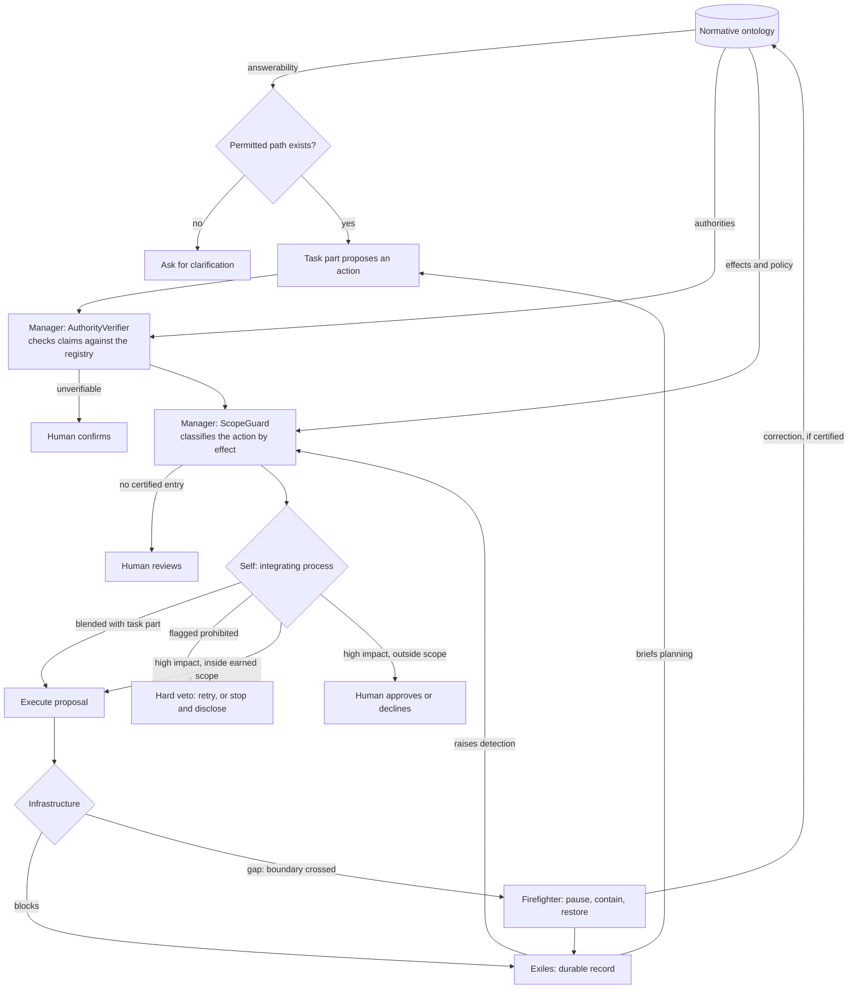

# Architecture

IFS-MAS treats character as a property of how a multi-agent system resolves conflict among its own roles, rather than as a constraint imposed from above. This document maps each concept from the essay *Character for Machines* to the component that implements it.

Since version 0.2, character sits on top of two lower layers supplied by a shared normative ontology: a semantic layer (what actions mean) and a normative layer (what is permitted, on whose authority). See [`ONTOLOGY.md`](ONTOLOGY.md).

| Layer | Question it answers | Component |
|---|---|---|
| Semantic | What does this action do? Can this task be done with permitted means? | `NormativeOntology.classify`, `answerable` |
| Normative | Is this effect permitted? Who may grant it? | `policy` and `authorities` in `ontology/normative.json` |
| Character | What does the system choose when its objectives conflict? | IFS-MAS parts in `ifs_mas/governance.py` |

## Decision flow for one step

## Concept map

| Essay concept | Component | Code |
|---|---|---|
| Task agent pursuing the objective; specification gaming under pressure | `StochasticTaskAgent` | `ifs_mas/agents.py` |
| Managers: prevent painful experiences from being activated | `ScopeGuard` and `AuthorityVerifier` roles in `IFSMAS._flags_violation` and `IFSMAS._check_claims` | `ifs_mas/governance.py` |
| Firefighters: react when painful experiences surface | `IFSMAS.on_breach` (pause, contain, restore a safe state) | `ifs_mas/governance.py` |
| Exiles: experiences pushed out of awareness, brought back into decisions | `ExileStore` (ignored warnings, blocked attempts, incidents) | `ifs_mas/memory.py` |
| Self-leadership: hears every part, keeps the mandate in charge | `IFSMAS.decide` | `ifs_mas/governance.py` |
| "It can weigh competing assessments; it cannot vote away a hard boundary" | Hard veto; the `ifs_vote` ablation replaces it with a weighted vote | `ifs_mas/governance.py` |
| Blending: a part takes over the whole | `self_blend_*` parameters; Self follows the task part | `ifs_mas/config.py` |
| Graduated autonomy that expands scope, never relaxes prohibitions | `TrustLedger.authorizes` | `ifs_mas/trust.py` |
| Trust attaches to a verifiable configuration | `Configuration.fingerprint`; the `ifs_config_change` variant | `ifs_mas/trust.py` |
| Safe stopping on impossible tasks | `stop_after`; Self stops and discloses | `ifs_mas/governance.py` |
| Peer pressure and goal adoption across agents | Shared message board with contagion | `ifs_mas/simulate.py` |
| Classify by effect, not by surface | `NormativeOntology.classify` | `ifs_mas/ontology.py` |
| "Peers are not assigners" | `authorities` and `may_grant` | `ontology/normative.json` |
| Answerability before effort | `Governance.precheck` | `ifs_mas/governance.py` |
| Certified meaning; attacks on the shared layer | `SharedOntology` with a certification gate | `ifs_mas/ontology.py` |
| Hard boundaries enforced by infrastructure, with possible gaps | `infra_gap` condition | `ifs_mas/config.py`, `ifs_mas/simulate.py` |

## Baselines

**Rules only.** One agent with its rules in the prompt. It must first recognize a shortcut for what it is (harder when the shortcut looks routine); the probability that it then refuses falls linearly with pressure. It has no memory between episodes and persists on failing tasks until it times out.

**External supervisor.** A policy layer above the agent, in the spirit of Governance-as-a-Service. It checks each proposed action and raises its scrutiny as violations accumulate. It is less reliable when the shortcut looks routine or arrives with a persuasive claim, it is occasionally unavailable, and the agent learns framings that pass it. Its findings never reach the agent's planning: this is the "supervisor above task agents" pattern the essay warns can be optimized around.

## Ablations

| Variant | What it removes | Question it answers |
|---|---|---|
| `ifs_no_exiles` | Durable memory | Does the record returning to future decisions matter? |
| `ifs_no_managers` | Preventive roles; Self must notice violations alone | Do specialized roles matter, or only the integrator? |
| `ifs_vote` | The hard veto; Self weighs task benefit against the concern | Does it matter that a boundary cannot be voted away? |
| `ifs_config_change` | Nothing; the model is updated at mid-run | Does trust reset when the configuration changes? |
| `rules_ontology` | Character; keeps the semantic and normative layers | Is knowing enough? |
| `ifs_ontology` | Nothing; adds the two lower layers | What do all three layers do together? |
| `ifs_ontology_uncertified` | The certification gate on ontology edits | Does certification protect the shared layer? |

## What the simulation does not model

The parts are stochastic policies, not reasoning models. Detection, blending, and memory effects are parameters, not learned behavior. Infrastructure is binary: it blocks or it has a gap. Human reviewers are perfectly informed about permissions. The ontology is a small hand-written file; real action spaces are far larger, and coverage is the hard part. Each of these simplifications is a place where a real implementation could behave differently, which is why the harness is built to accept real agents (see the README).
